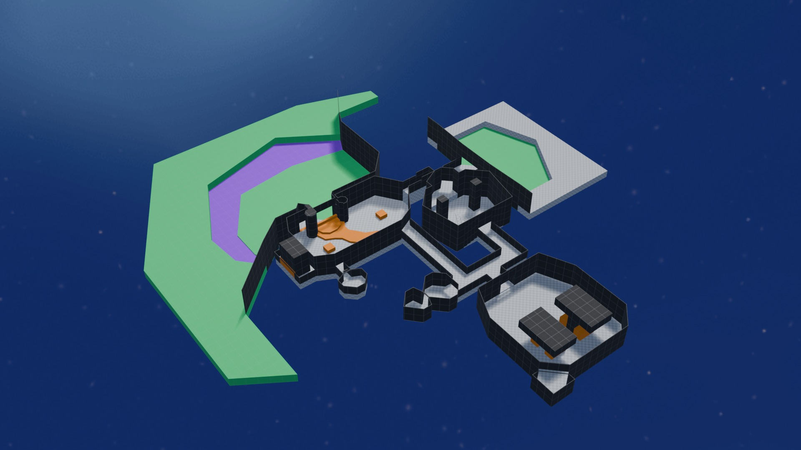

# Blocksmith

**English** · [Español](docs/README.es.md) · [Français](docs/README.fr.md) · [Deutsch](docs/README.de.md) · [Русский](docs/README.ru.md)

Draw editable level blockouts in **Blender 5+** and export them to **Godot**. Version **0.8.7**, licensed under **GPL-3.0-or-later**.

Blocksmith is an independent implementation inspired by publicly described BlockD workflows. It does not implement every BlockD feature. The interface supports English, Spanish, French, German and Russian. Choose your language in **Edit → Preferences → Interface → Translation** and enable **Interface** and **Tooltips**. Blocksmith follows Blender’s language; existing object names are preserved.

## Features

- Draw walls, floors, rooms, stairs and ramps directly in the viewport; choose from 32 presets with previews.
- Edit dimensions through the sidebar or viewport handles. Room floors and walls, doors, windows, arches, roofs, railings and curved walls are supported.
- Snap to a grid, visible vertices and edges, including evaluated Boolean and Array geometry. Join straight walls with miter, butt and T joints.
- Draw non-destructive door, window and arch cuts on existing solid meshes. Repeat objects or openings with the row tool.
- Connect two levels with straight stairs or a ramp. Display player references and scale hints for steps, openings, cover and slopes.
- Apply bundled Kenney prototype textures, assign gameplay tags, and export GLB or FBX.
- Mark individual meshes for **free placement** to bypass Blocksmith's geometry restrictions.
- Generate levels from validated JSON through a Python CLI, without installing the add-on in your personal Blender session.

## CLI example: Entryway in space



[Open the complete example](examples/entryway-space): a downloadable `.blend` map,
five space skyboxes, Eevee renders, source data and exact terminal commands.
[Watch the eight-second Eevee video](examples/entryway-space/renders/entryway-eevee.mp4).
The level geometry was created with Python through Blocksmith’s native CLI;
a separate Blender CLI script sets the skybox, lights and cameras.

## Installation

1. Download `blocksmith-0.8.7.zip` from [Releases](https://github.com/hlophlopgaming/Blocksmith/releases), or build it from this repository:

   ```sh
   python3 tools/package.py
   ```

2. In Blender, open **Edit → Preferences → Get Extensions → top-right menu → Install from Disk**. Select the downloaded ZIP or `dist/blocksmith-0.8.7.zip` and enable the extension.
3. In the 3D Viewport, press **N** and open the **Blocksmith** tab.

Building requires Python 3.10+ and no third-party Python dependencies. GitHub's automatic **Source code** archives are source distributions, not installable extension ZIPs.

## Quick start

1. Click a shape under **Create**, or press **Shift+Alt+D** to activate the current shape.
2. Choose a shape in the two-column **Create** section; expand **Drawing Settings** for dimensions and snapping. Open **Preset Catalog** for the preset catalog.
3. Drag with the left mouse button, then release to create the structure. Select it to edit its dimensions or drag the orange handles.
4. Keep **Repeat** enabled to draw more pieces. **Esc / right-click** cancels an unfinished gesture or returns to selection.

During ordinary drawing, **Ctrl** temporarily disables snapping, **Shift** constrains the direction to 45° increments or makes a square footprint, **H** adjusts height, and **F** reverses stairs or ramps. Navigation and sidebar controls remain available between gestures.

For straight stairs or ramps, drag from the lower floor to the upper landing edge; the reverse gesture also works. For a door, window or arch, drag a rectangle directly on a solid mesh. Each completed opening adds a non-destructive Boolean cut. Curved walls use points, a freehand stroke or a three-point arc. See the [detailed Russian manual](docs/manual.ru.md) for advanced tools and their individual controls.

Turn off **Enable Blocksmith in This File** at the top of the sidebar to model or sculpt freely. The switch is saved in the `.blend` and applies to all its scenes. Tools, shortcuts, dimension overlays, property-driven updates and geometry rollbacks pause; the add-on stays installed and enabled. Resume with the same switch. Current mesh edits are accepted without restoring old geometry; manually edited modules retain their edit protection. Native Blender snapping settings stay as you left them.

## Free placement

Select a mesh and enable **N → Blocksmith → Ignore Blocksmith Rules**. This is a persistent property on the object, available in Object Mode and Edit Mode. For several selected meshes, use **Apply to Selected** after setting the active mesh’s flag.

Marked meshes can overlap other objects, move, rotate, scale, use negative scale, and receive manual edits or reversed normals without being rolled back by Blocksmith. Other modules can also overlap a marked mesh. The mark preserves geometry, materials and gameplay tags, survives duplication, baking and `.blend` save/load, and keeps the mesh available for snapping and export unless its role already excludes it, such as a cutter or reference figure.

Turning the flag off restores the usual protection for a Blocksmith module. If its current state violates the rules, protection stays off; the mesh and its manual edits are preserved. Fix its intersections, scale or normals first. Ordinary Blender meshes are unrestricted even without this mark. The operation supports Undo/Redo.

For scripts, select the meshes and use:

```python
obj.bs.free_placement = True  # persistent flag on one object
bpy.ops.blocksmith.free_placement(enabled=True)  # selected meshes
bpy.ops.blocksmith.free_placement(enabled=False)
```

The mark bypasses validation: overlapping or invalid marked geometry can reach your export. Blender snapping and dimension hints remain separate settings. A parent transform may still be rejected if it affects a protected child.

## Geometry protection

Unmarked Blocksmith modules reject intersections, negative or zero scale, open meshes and reversed normals. Face contact is allowed. Checks use actual evaluated geometry rather than bounding boxes alone. Ordinary/imported Blender meshes, reference figures, water and active Boolean cutters are outside the solid-module checks.

Protection applies to add-on operations, native transforms, edits after leaving Edit Mode, and Undo/Redo. Export validates protected modules again. Existing scenes are accepted as a starting state without deleting their objects, but conflicting protected geometry must be fixed before export. Checks are numerical, can be slower on large or complex scenes, and are not a mathematical guarantee.

## Export to Godot

Open **Export to Godot**, choose **GLB** or **FBX**, an export scope, destination folder and filename. Save the `.blend` first if using a relative output path.

GLB is the main tested format. With collision enabled, solid meshes receive the Godot `-col` suffix. Water exports visibly without collision; reference figures, cutters in use, hidden source archives and temporary guard objects are excluded. Curved walls are converted to meshes. Existing export files are not overwritten: choose another filename or folder.

## JSON CLI

Run from the repository root with Python 3.10+ and Blender 5+ in `PATH`:

```sh
python3 tools/levelgen.py shapes
python3 tools/levelgen.py presets
python3 tools/levelgen.py schema
python3 tools/levelgen.py validate examples/courtyard.json
python3 tools/levelgen.py generate examples/courtyard.json --out-dir generated/courtyard
```

Generation produces `level.blend`, `level.glb`, `level.spec.json`, `report.json` and `blender.log`. Use `--blender /path/to/blender` for a custom executable and `--overwrite` to replace previous output. Generation runs in a separate background Blender process and preserves prior exports if validation fails. Output is JSON; errors use stderr and a nonzero exit code.

The specification uses **meters**, Blender **Z-up** coordinates and Euler rotation angles in **degrees**. GLB converts to Godot's Y-up coordinates. See [the schema](examples/level.schema.json), [examples](examples/) and the CLI's `schema` command. Unknown keys, duplicate names, invalid numbers and excessive complexity are rejected; JSON never executes Python. The free-placement mark is a Blender mesh setting, not a field in the current CLI schema.

## Development and checks

```sh
python3 -m unittest discover -s tests -p 'test_*.py' -v
blender -b -noaudio --factory-startup --python-exit-code 1 --python tests/free_placement_check.py
blender -b -noaudio --factory-startup --python-exit-code 1 --python tests/guard_check.py
python3 tools/package.py
```

See [CONTRIBUTING](CONTRIBUTING.md), [CHANGELOG](CHANGELOG.md) and the [0.8.3 validation report](docs/validation-0.8.3.md). GitHub Actions is configured to run Python tests, check syntax and build the extension. Viewport tests require a graphical environment. Backups, builds and generated scenes are excluded from Git.

## Current limits

Blender 5.0 is the declared minimum; it has not been tested separately. Earlier checks covered Blender 5.2.3, 5.3.0 and Godot 4.7.2. FBX has less validation coverage than GLB. Wall chains do not automatically close or move neighboring walls when one is edited. Use **Shift+D** for independently editable copies; **Alt+D** shares a mesh but not its parameters. Apply Scale supports positive uniform scale on unedited, single-user parametric meshes. Scale hints do not simulate a game controller. Exported collision is a static triangle mesh. Blockout meshes may need optimization for production.

## License

Blocksmith code: **GPL-3.0-or-later**, see [LICENSE](LICENSE). A copy is included in the installable extension.

Bundled [Kenney Prototype Textures](https://kenney.nl/assets/prototype-textures): **CC0**. Their [license](blocksmith/assets/kenney/License.txt) and [source information](blocksmith/assets/kenney/SOURCE.txt) are preserved with the assets.
