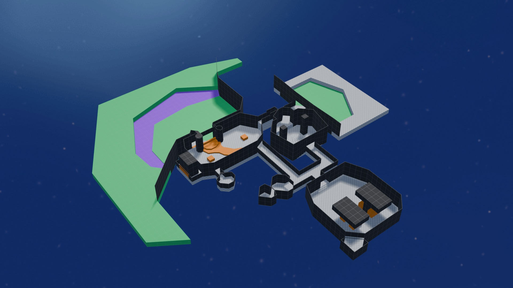

# Blocksmith 0.8.7 — contour drawing and a CLI-built Entryway example

New **Contour Floor** and **Contour Volume** tools create editable geometry from
snapped points or a simplified freehand stroke. Concave outlines and up to 16 holes
stay in one object without Boolean cutters. Edit individual points, resize the
result, draw extruded profiles on surfaces, and export through the existing workflow.

This release also includes the recent file pause, creation panel, precise curve
and placed-opening editing improvements recorded in the changelog.

## A complete example created with code through the CLI

The DOOM II MAP01 Entryway blockout was reconstructed from room boundaries and
height data using Blocksmith's native CLI: **185 editable modules, 34 contour
structures and 11 CUT helpers**. Geometry was created by `bs.create`, `bs.rebuild`
and the Blocksmith CUT operator, without manual mesh modeling.

The space skybox, lighting, cameras and **Eevee** renders were then set up by a
separate Python script run through Blender's command line. Five supplied skyboxes
are included. The `.blend` asset packs the active Galaxy skybox and model textures.

[Example, source data and exact CLI commands](https://github.com/hlophlopgaming/Blocksmith/tree/main/examples/entryway-space)

The example includes `entryway-eevee.mp4`: an eight-second Eevee video at
1280×720, 24 fps, plus the script and commands to reproduce it.

Download `blocksmith-0.8.7.zip` and use **Install from Disk** in Blender's extension
preferences. `Entryway-Space.blend` is the ready-to-open example map.

Validated on Blender 5.3: 20 Python tests; native geometry, guard, persistence,
export and viewport interaction checks, including Undo/Redo. Eevee rendering does
not change the construction meshes. The map is an architectural demonstration,
with static doors and lifts; it is not a playable DOOM port.
