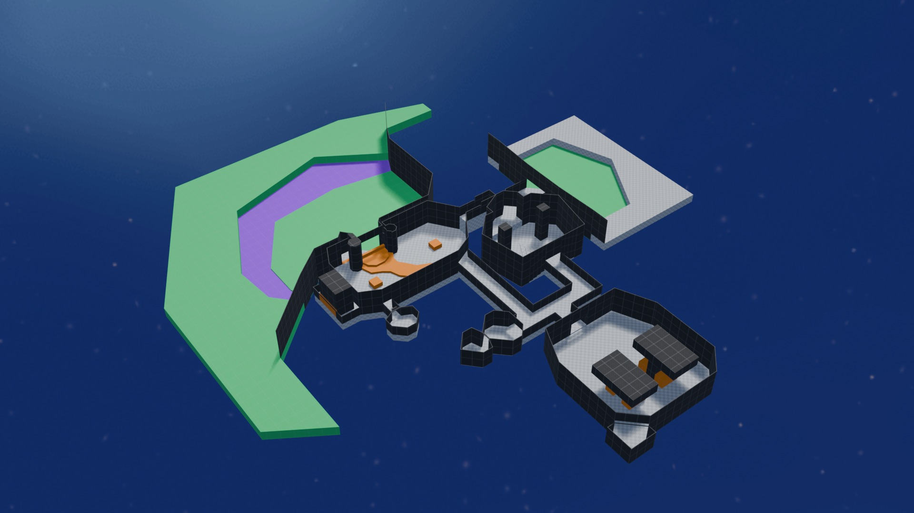
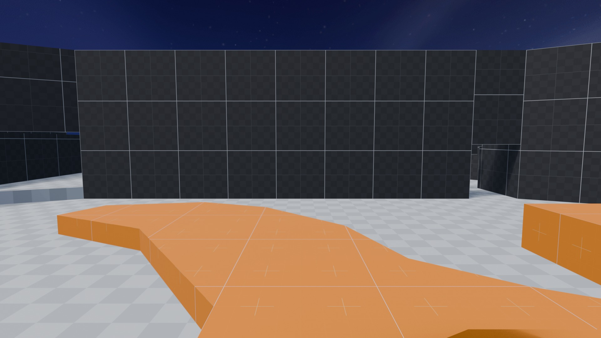
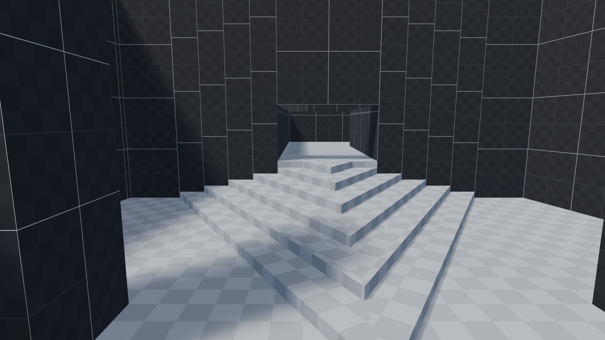
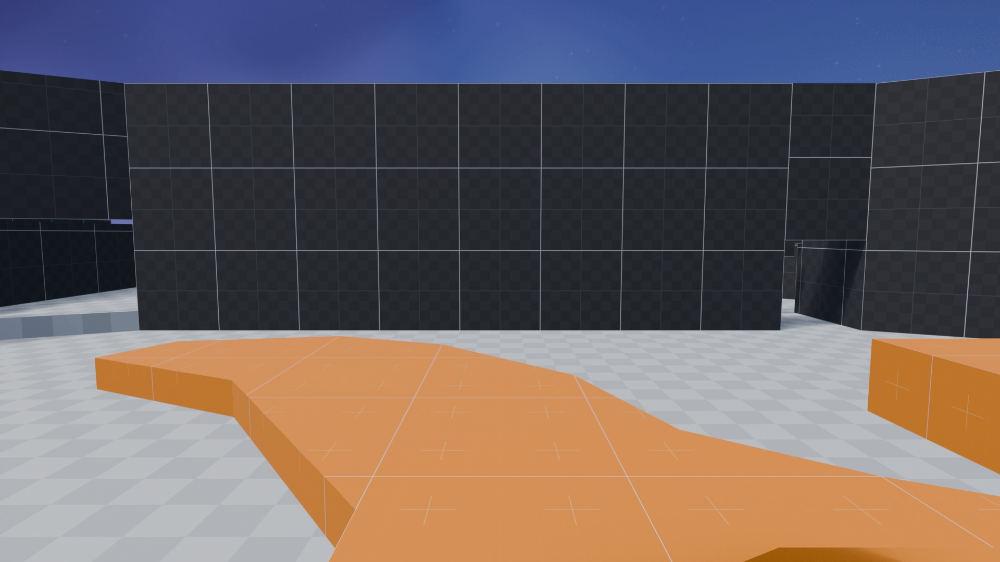
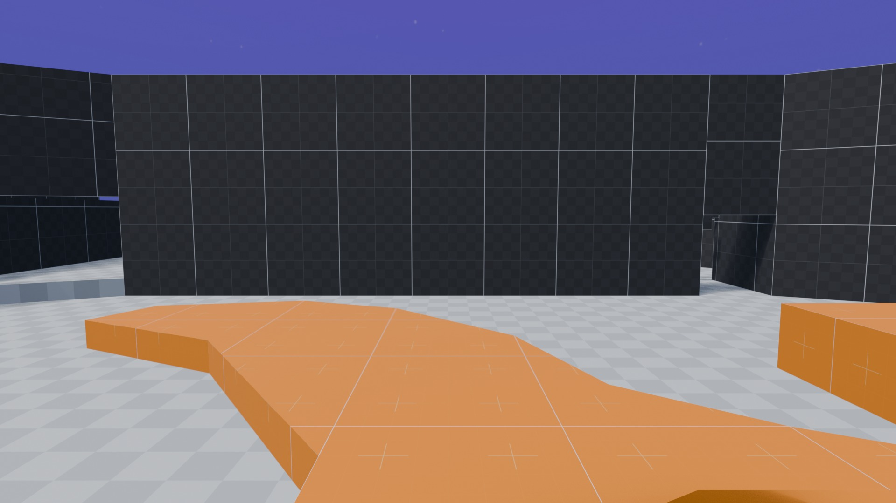
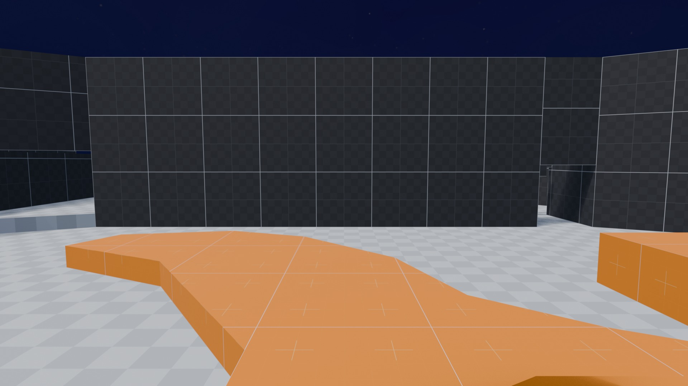
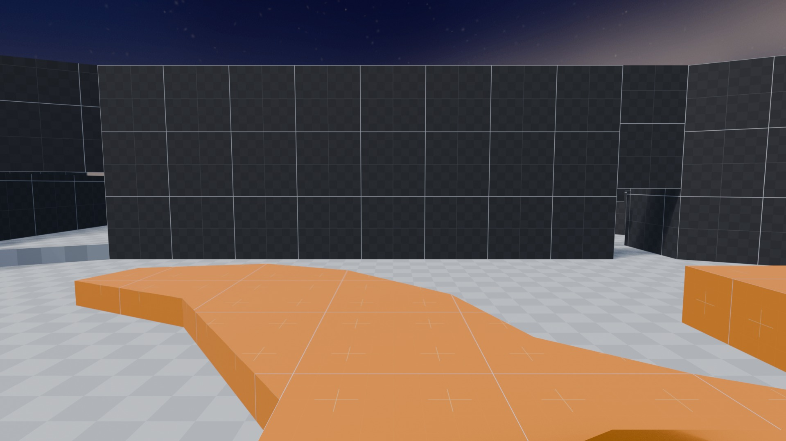

# Entryway in space — built with code through the Blocksmith CLI



This is a complete reconstruction of the DOOM II MAP01 Entryway blockout, created
with Python and Blocksmith's native command-line generator. **The geometry was
built with code through the CLI, not modeled manually in Blender.**

Open [Entryway-Space.blend](Entryway-Space.blend) in Blender with Blocksmith **0.8.7**
for editable contour parameters. The active Galaxy skybox and model textures are
packed in the file. Frames 1–3 switch the overview, entry hall and stair hall cameras.

[Watch the eight-second Eevee video](renders/entryway-eevee.mp4) — 1280×720, 24 fps,
with an overview orbit and two interior shots.

## What Blocksmith creates

- 185 editable modules, including 34 complete contour floors, platforms and solid structures.
- Two native six-step STAIRS flights, mitred walls, ceiling changes and overhangs.
- Concave room outlines with holes kept in single POLY_FLOOR/POLY_BLOCK objects.
- 11 native CUT helpers for the remaining wall joins and stair bounds.
- Kenney prototype textures, gameplay tags and a GLB export with static collisions.

The original 59 sector records are grouped into 15 room foundations, with raised
platforms built separately. The chevron stairs preserve their footprint and landing
heights using regular flights; their intermediate fan-shaped treads are approximated.

The provided space skyboxes, lights and cameras are scene presentation set up with
Blender's Python interface. They are separate from Blocksmith's geometry generation.
All published renders use **Eevee**.

## Reproduce from the terminal

From the repository root, with Python 3.10+ and Blender 5+ in PATH:

```sh
# Derive the native specification from room boundaries and heights.
python3 examples/entryway-space/generate_spec.py

# Validate and construct the level using the actual Blocksmith CLI.
python3 tools/levelgen.py validate examples/entryway-space/level.blocksmith.json
python3 tools/levelgen.py generate examples/entryway-space/level.blocksmith.json --out-dir generated/entryway-space --timeout 300

# Add the supplied skyboxes, lights and cameras, then render with Eevee.
blender --background --factory-startup generated/entryway-space/level.blend --python-exit-code 1 --python examples/entryway-space/render.py -- --out-dir generated/entryway-space --samples 64
```

The first generation command produces `level.blend`, `level.glb`, the validated
specification and a report. Rendering adds `Entryway-Space.blend`, an overview,
two interior views and five skybox variants of the same entry-hall camera.
Use a new output directory or the CLI's `--overwrite` flag to regenerate existing files.

`render.py` changes only World settings, lights, cameras and render settings;
it asserts that construction meshes and their transforms stay unchanged.
[Geometry verification](geometry-verification.json) and [render report](render-report.json)
record the checks used for this example.

## Reproduce the video

With Blender and ffmpeg in PATH, from the repository root:

```sh
blender --background --factory-startup examples/entryway-space/Entryway-Space.blend --python-exit-code 1 --python examples/entryway-space/render_video.py -- --out-dir generated/entryway-video
ffmpeg -framerate 24 -start_number 1 -i generated/entryway-video/%04d.png -frames:v 192 -c:v libx264 -crf 20 -pix_fmt yuv420p -movflags +faststart generated/entryway-eevee.mp4
```

The video script uses Eevee with 32 samples and asserts that all 196 construction
meshes keep their geometry and transforms. It does not save over the example file.
Use `--preview` to render one frame per shot before the full sequence.

## Views and skybox variants





| Nebula | Galaxy | Day |
| --- | --- | --- |
|  |  |  |

| Dark | Band |
| --- | --- |
|  |  |

## Inputs and attribution

`map01-sectors.json` contains numerical boundaries and height data extracted from
the [Video Game Level Corpus](https://github.com/TheVGLC/TheVGLC/tree/master/Doom2/Original).
The level is an independent architectural blockout; original DOOM textures,
sprites, sounds and gameplay code are not included. DOOM II and MAP01 are the
work of their respective owners.

Materials use the bundled CC0 Kenney prototype textures. The five skybox PNGs were
supplied by the maintainer for this example. The active skybox is also packed in
the `.blend`; all five source images are in [skyboxes](skyboxes).
